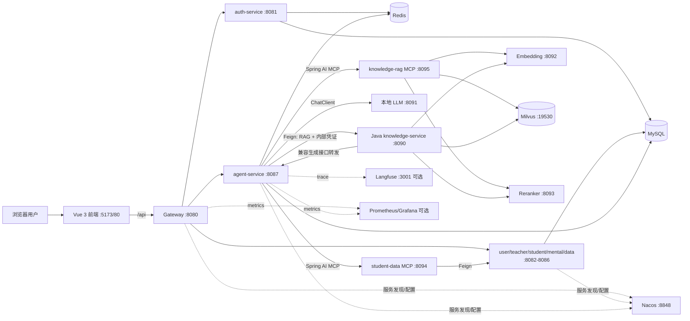
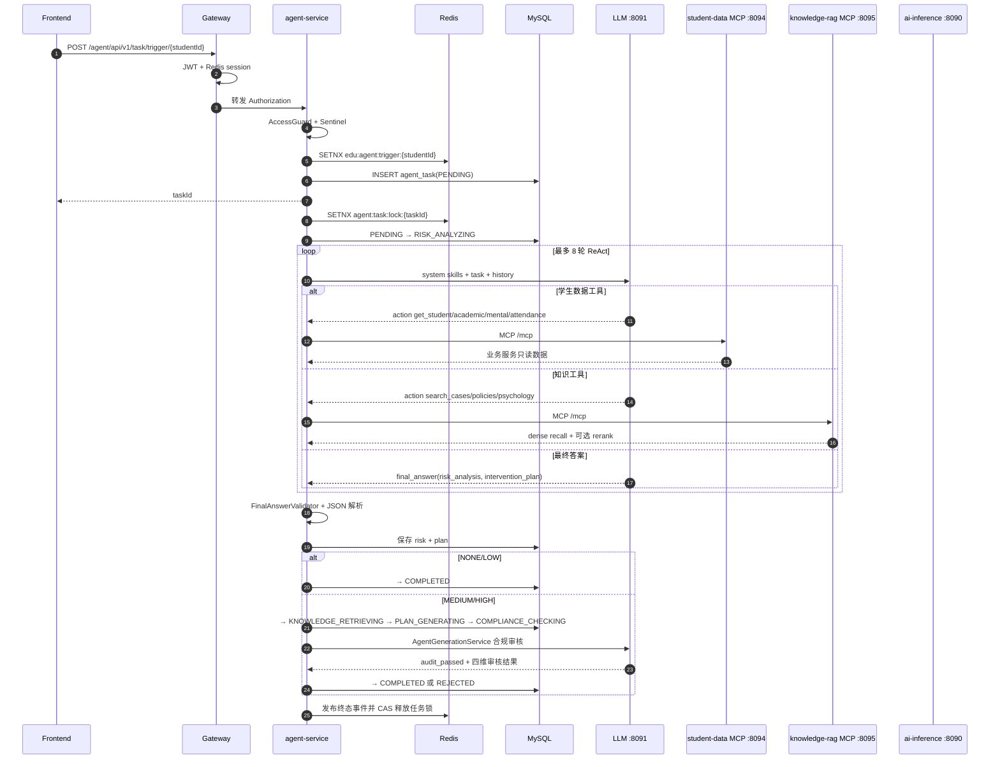

# Resource-Profile 架构说明

> 最近更新：2026-10-15
> 状态：按当前仓库实现初始化；真实模型与生产全栈仍待 `docs/educare/EXECUTION_PLAN.md` 的 R-5/R-6 验收。

本文说明项目级模块边界、核心调用链与数据流。EduCare 的历史计划与原子任务状态以 [`docs/educare/EXECUTION_PLAN.md`](./docs/educare/EXECUTION_PLAN.md) 为准；本文只描述当前仍在代码中的能力。

## 1. 系统边界

当前 Kamatera 可观测迁移以文末 `LANGFUSE-OTLP-20261007` 为准；旧版 Langfuse v2 的描述仅适用于历史自建环境。

Resource-Profile 是师生资源画像与教育风险干预平台。系统由 Vue 前端、Spring Boot 微服务、Java knowledge-service（Spring AI embedding/MCP）、本地 OpenAI 兼容模型和数据基础设施组成。

### 1.1 模块职责

| 模块 | 端口 | 拥有的职责 | 不应承担的职责 |
|---|---:|---|---|
| `frontend` | 5173（开发）/ 80、443（生产） | 页面、路由、Pinia 状态、调用 `/api`、SSE 展示 | 鉴权裁决、字段脱敏、业务数据持久化 |
| `gateway` | 8080 | 路由、JWT 校验、Redis 会话白名单、`/_internal/` 阻断、CORS | 领域业务和数据库写入 |
| `common` | — | `Result<T>`、JWT、`AccessGuard`、字段权限、异常自动装配、Prompt 清洗 | 独立运行、持有领域数据 |
| `auth-service` | 8081 | 登录、刷新、登出、用户角色、Redis 会话 | 用户/学生/教师资料管理 |
| `user-service` | 8082 | 系统用户管理 | 登录发 token |
| `teacher-service` | 8083 | 教师档案 | 学生或心理业务 |
| `student-service` | 8084 | 学生档案、成绩、考勤 | 心理问卷、AI 编排 |
| `mental-service` | 8085 | 问卷、题目、作答和心理评估 | 通用用户管理、AI 推理 |
| `data-service` | 8086 | 仪表盘聚合与统计 | AI 任务状态和模型调用 |
| `agent-service` | 8087 | 风险任务、AgentLoop、合规审核编排、导出、干预反馈、SSE 预警 | 向量存储实现、业务主数据维护 |
| `mcp-student-data` | 8094 | 将学生档案、成绩、心理、考勤封装为 4 个只读 MCP 工具 | 直接拥有业务表或写业务数据 |
| `knowledge-service`（兼容服务名 `ai-inference-service`） | 8090 | Java dense RAG、知识导入/初始化；生成兼容接口转发到 agent-service | 自行编排生成、业务主数据 |
| `knowledge-rag-mcp`（同一 Java jar，API 关闭） | 8095 | Spring AI 将案例、政策、心理知识检索封装为 3 个 MCP 工具 | 学生主数据、任务状态 |

### 1.2 基础设施边界

| 组件 | 用途 | 数据性质 |
|---|---|---|
| MySQL 8 | 用户、师生、心理、Agent 任务、报告、反馈 | 业务事实源，必须备份 |
| Redis 7 | 登录会话、幂等键、分布式锁、RAG/embedding 缓存、SSE 事件/检查点 | 可重建状态；丢失会导致会话失效和缓存清空 |
| Nacos 2.3 | Java 服务发现与可选配置源 | 控制面配置 |
| Milvus 2.4 + etcd + MinIO | 1024 维知识向量与索引 | 可由源文档重新灌库，不是业务事实源 |
| 本地模型 :8091/:8092/:8093 | 生成、embedding、rerank | 仓库不保存模型权重 |
| Langfuse Cloud / OTLP | Java `agent.loop`、`llm.chat`、`llm.risk`、`llm.plan`、`llm.audit`；内容默认关闭 | 可选可观测数据；旧 self-host v2 profile 不兼容新客户端 |
| Prometheus/Grafana | HTTP/JVM/Agent 指标、看板与告警 | 可选运行指标 |

### 1.3 单主机云部署边界（OCI-DEPLOY-20261006 / KAMATERA-DEPLOY-20261006）

当前平台选择已改为 Kamatera（2026-10-06 / KAMATERA-DEPLOY-20261006）。部署操作见 [Kamatera 部署手册](./docs/deployment/KAMATERA_DEPLOYMENT.md)；OCI 账号与资源方案保留为历史候选。用户已创建新加坡 `resource-profile-sg`，公网 IPv4 `45.130.165.168`，实际 Rocky Linux 9.8、Type A 4 核 / 24 GB / 100 GB。控制台月付 US$92、含 1000 GB 流量、无每日备份和托管附加项；US$10 押金已到账。主机 SSH key 经控制台跨通道 nonce 和 fingerprint 校验后固定到专用 known_hosts。30 天试用不代表长期免费；Type A CPU 资源不保证，容量和性能须真实负载验证。

用户已明确选择 K3s + HPA（2026-10-06 / K3S-HPA-DEPLOY-20261006），本次正式编排改为 [`k8s/workloads.json`](./k8s/workloads.json) 与 [`scripts/k3s-deploy.py`](./scripts/k3s-deploy.py)。11 个 Java 进程（2026-10-15 源码配置；生产切换待验收）、MySQL/Redis/Milvus/etcd/MinIO 与 Caddy 前端共 17 个工作负载，通过 ClusterIP 与服务 DNS 在同一主机内通信；关闭 Nacos，以显式 URL 保留领域调用契约。Docker 仅负责镜像构建，镜像导入 K3s 独立 containerd；[`docker/docker-compose.cloud.yml`](./docker/docker-compose.cloud.yml) 保留为环境来源和备选运行方式，不与 K3s 同时启动。只有通过发布门的 Caddy 使用 hostPort TCP 80/443，API 与 SSE 同源；其余服务没有公网端口。K3s 禁用 Traefik/ServiceLB，保留 CoreDNS、metrics-server 和 local-path。节点 API 可监听节点地址，但 firewalld 禁止公网 6443/8472/10250，管理仅经 SSH 本机执行。

首轮仅 data-service 启用 HPA（CPU request 100m、目标 70%、副本 1–2、缩容稳定窗口 300 秒）。其余工作负载固定 1；agent 本地 executor/PDF 文件、MCP 会话和 Python 知识导入尚未完成跨副本及缩容验收。SSE 已有 Redis fan-out，不因此误判为完全无法多副本。全栈基础 requests 为 1.8 CPU / 9.1875 GiB，limits 为 17.25 GiB，HPA 最大 limits 为 17.75 GiB；这些预算不是实际吞吐证明。HPA 只改变 Pod 数，不增加 VM 容量或提供节点高可用。持久化为 8 个单机 local-path PVC，共申请 46 GiB；单例升级采用 Recreate，数据不具备跨节点复制。

此部署的生成模型和 embedding 使用外部 HTTPS API；[`embedding_client.py`](./ai-inference-service/app/services/embedding_client.py) 支持独立 `EMBEDDING_API_KEY`，为空时兼容共享生成模型密钥。可选 reranker 默认关闭，dense RAG、双 MCP 和 AgentLoop 保留。真实学生/心理数据迁移及外部模型处理必须先确定授权范围；准备配置不代表已迁移数据、已取得模型使用额度或完成 R-5/R-6。

KAMATERA-DEPLOY-20261006 同步修复 [`main.py`](./ai-inference-service/app/main.py) 未注册知识导入路由的问题：`POST /api/v1/rag/upsert` 进入既有 RAG upsert 处理链，继续以 `X-Admin-Token` 校验后调用 embedding、Milvus 和 Redis 幂等缓存。端点只供私网管理灌库，Caddy 不为其新增公网业务路由；无模块所有权变化。回归通过实际 `create_app()` 构建应用，防止测试手工注册路由掩盖生产遗漏。

共享部署工具使用运行源码白名单生成上传包；合法 Java `com/edu/data` 包、生产提示词/skills 与 Spring 自动配置元数据必须保留，真实 env、SSH 私钥、业务数据和访谈不进入归档。中文 PDF 字体以 `CLOUD_EXPORT_FONT_FILE` 指向主机静态 TrueType 文件，仅只读挂载到 agent-service，并通过既有 `EDUCARE_FONT_PATH` 设置；不改变导出服务接口。字体来源/许可与构建证据见 Kamatera 手册。

Rocky 保持 SELinux Enforcing，Docker SELinux 支持及 hello-world 已实测通过。K3s 必须使用官方 k3s-selinux 策略和 `selinux: true`；SQL/字体只读 hostPath 需限定源路径的持久 `container_file_t:s0` 标签，不能照搬 Docker `:Z`。应用环境和 Milvus 凭据使用 Kubernetes Secret（Milvus 文件 0600），K3s Secret 加密存储、kubeconfig 0600；真实私有 JSON 清单不入 Git/日志。Caddyfile 本身无秘密，使用 ConfigMap。备用 Compose 保留三个只读 Z bind 与来源门禁，避免缺失来源被自动创建；K3s 与 Compose 的 SELinux 访问均须分别实测，不能关闭 Enforcing 绕过。

K3s 发布门复用 [`scripts/cloud_deploy.py`](./scripts/cloud_deploy.py) 的配置、字体、容量与密码规则，再核对实际 bcrypt 改密、DNS、真实生成/embedding 响应和全部私有 Pod Ready，才创建 frontend 并验证受信 HTTPS；失败移除公共入口并保留 PVC。完整栈目标 24 GiB、启动门 ≥20 GiB。域名/模型凭据、真实容器/模型/RAG/TLS/HPA 与备份恢复仍待验收；准备清单、空向量集合与 mock 不能替代这些证据。

## 2. 核心调用链

### 2.1 登录与普通业务请求

1. 前端调用 `POST /auth/login`。
2. `auth-service` 校验 bcrypt 密码，生成 HS256 JWT，并把 access token 写入 Redis `token:{userId}`。
3. 后续请求携带 `Authorization: Bearer <token>`；SSE 可使用 `?token=`。
4. `gateway` 先校验签名和过期时间，再比对 Redis 中的当前会话；Redis 异常时 fail-closed 返回 503。
5. 请求路由到领域服务。服务入口 `ServiceAuthFilter` 先确认带合法 JWT 或内部凭证（下游在 Render 上公网可达，不能只靠网关）；`AccessGuard` 做 self/role/已验证内部调用判断，`FieldPermissionAdvice` 按角色过滤敏感字段。
6. 登出或重新登录会删除/覆盖 Redis 会话，旧 token 立即失效。

### 2.2 默认 AgentLoop 风险画像链

关键约束：

- `educare.agent.loop.enabled=true` 是默认主路径；`false` 回落 legacy 流水线。
- 默认协议是可观察的 `react`；`native` 只作为可选协议，两路都必须经过 ToolGuard 和最终答案校验。
- AgentLoop 暴露 7 个工具：`get_student_profile`、`get_academic_history`、`get_mental_indicators`、`get_attendance`、`search_cases`、`search_policies`、`search_psychology`。
- 工具调用先过白名单/敏感工具守卫；最终答案必须含合法的 `risk_analysis` 与 `intervention_plan`。
- NONE/LOW 在风险阶段短路；MEDIUM/HIGH 必须经过 Java Spring AI 合规审核。审核异常返回人工审核结果并转 `REJECTED`，不能静默放行。
- 任务状态更新使用带前置状态的 CAS SQL；任何未处理异常落为 `FAILED`。

### 2.3 Legacy 回退链

当 `EDUCARE_AGENT_LOOP_ENABLED=false` 时：

1. `StudentPortraitAggregator` 通过 Feign 聚合 student/mental/data 数据并在送模前脱敏。
2. `RiskAnalyzeService` 直接调用本地 ChatClient 生成风险 JSON。
3. 中高风险通过带 `X-Internal-Token` 的 Feign 调用 Java `/api/v1/rag/retrieve` 做多 query、多集合 dense 检索。
4. Java `AgentGenerationService.generatePlan` 通过 Spring AI 生成干预方案。
5. Java `AgentGenerationService.complianceAudit` 做合规审核；字段最小化、严格 JSON、四维结果与总判定一致性校验。
6. 最终写入与默认路径相同的 `agent_task` 状态机。

Legacy 是故障回退和真实模型对比基线，不是默认新功能入口。

### 2.4 Dense RAG 数据流

1. Java `knowledge-service` 的 `/api/v1/rag/upsert` 支持 `none`、`fixed_size`、`sentence` 切块；`X-Admin-Token` 为强制写入边界。`/api/v1/rag/initialize` 只创建缺失集合、验证已有向量维度，绝不删除/重建已有集合。
2. Spring AI `OpenAiEmbeddingModel` 使用独立 embedding URL/密钥；保留 `edu_cases`、`edu_psychology`、`edu_policies`、`edu_success` 的 auto-ID / embedding / chunk_id 字段。Milvus REST v2 适配层兼容原 schema，不自动采用不同的 VectorStore 布局。
3. 多 query、多集合 dense 召回；跨集合同名 chunk 不互相覆盖，按最高分去重，保留可选 HTTP rerank 与出处字段。
4. Embedding 维度、非零、有限值校验；缓存区分 provider/model/dim，知识缓存随 revision 失效。Redis/Milvus/embedding 故障显式失败，只有真实零结果返回空 chunks/fallback。
5. 导入使用集合级 Redis 写锁；全部向量就绪后先插新片段、再按精确旧 PK 删除。写前失效旧幂等 hash 与检索 revision，失败不删除旧文档；非事务式 Milvus 写入部分成功时可能暂存重复片段，须按 RUNBOOK 重试同一完整文档修复。

当前实现是纯 dense 检索；历史 Hybrid Retrieval、Elasticsearch/BM25 路径已经删除。

## 3. 数据所有权与流向

### 3.1 MySQL

- 身份与权限：`sys_user`、`sys_role`、`sys_user_role`、权限关联表。
- 师生业务：`teacher_info`、`student_info`、`student_academic_record`、`student_attendance`。
- 心理业务：问卷、题目、作答、`mental_assessment`。
- Agent：`agent_task`、`intervention_report`、`knowledge_citation`、`agent_export_task`、`audit_log`。
- 干预闭环：`intervention_feedback`。

领域服务只能修改自己负责的数据；跨域读取通过 HTTP/Feign/MCP 完成，不跨服务直接复用 mapper。

### 3.2 Redis 关键键

| Key | TTL/生命周期 | 用途 |
|---|---|---|
| `token:{userId}` | access token 生命周期 | 当前登录会话白名单 |
| `edu:agent:trigger:{studentId}` | 默认 30 秒 | 防重复触发 |
| `agent:task:lock:{taskId}` | 默认 120 秒 | 防并发执行同一任务 |
| `edu:agent:schedule:daily-scan` | 定时任务窗口 | 多实例扫描锁 |
| `edu:emb:*` | 默认 24 小时 | embedding 缓存 |
| `edu:rag:*` / `edu:rag:pipe:*` | 默认 1 小时 | REST/MCP RAG 缓存 |
| `edu:rag:upsert:hash:*` | 默认 7 天 | 知识导入幂等 |

锁释放使用 value-owner 比对后删除，避免误删其他实例获得的锁。

## 4. 安全边界

- 公网生产入口只允许 nginx 80/443；gateway、数据库、Redis、Nacos、Milvus、Agent 与 MCP 端口都绑定 `127.0.0.1` 或容器内网。
- gateway 是第一道 JWT + 会话门；agent-service :8087 还有独立 `AgentSelfAuthFilter`，防本机直连绕过网关。
- **网关不是唯一入口**：Render 部署下每个下游服务都是独立的公网 Web Service。user/teacher/student/mental/data 由 common 的 `ServiceAuthFilter` 在服务入口要求「合法 JWT」或「合法内部凭证 `X-Internal-Token`」，否则 401。内部凭证是共享密钥 `EDUCARE_INTERNAL_TOKEN`，只由 agent-service（student/mental/data 客户端）与 mcp-student-data（student/mental 客户端）的 Feign 附带，常量时间比较；网关 `InternalHeaderStripFilter` 剥掉客户端自带的同名头。未配置密钥即不承认任何内部调用（fail-closed）。
- `AccessGuard` 负责对象级授权：带 token 按本人/角色判定，不带 token 只有出示合法内部凭证才放行。字段权限默认开启：仅已验证的内部调用不脱敏，匿名请求只留 PUBLIC 字段。详见 `docs/educare/FIELD_PERMISSION.md` §11（INTERNAL-AUTH-20260914）。
- agent-service 与两个 MCP server 可通过同一 `EDUCARE_MCP_TOKEN`/`X-MCP-Token` 互验；生产 preflight 强制其与 Redis 密码均不少于 32 字符。
- 进入 LLM 的画像经过 `DataMasker`/`PromptSanitizer`；敏感心理工具还受 ToolGuard 约束。
- `/agent/**/_internal/**` 经 gateway 一律 403。任何新增内部端点必须保持该边界。
- 部署密钥只存在于未跟踪的 `docker/.env`（或仓库外经 `ENV_FILE` 指定的文件）与 Render/Aiven/Groq 秘密存储。`docker/.env.*` 除模板外一律忽略，preflight 拒绝被 git 跟踪的 env 文件；仓库公开，任何入库过的真实值都视为已泄露、必须轮换（`ENV-AUDIT-LEAK-20260914`）。

### 4.1 MENTAL-AUTHZ-20261005：心理问卷端点授权与作答视图

2026-10-05 补齐既有 `MENTAL-AUTHZ-20260914` 实现的项目级文档。服务入口的 JWT/内部凭证验证只解决
身份准入；心理管理端点在 [MentalController](./backend/mental-service/src/main/java/com/edu/mental/controller/MentalController.java)
继续执行角色授权，角色集合统一定义在 [Roles](./backend/common/src/main/java/com/edu/common/security/Roles.java)。

| 边界 | 当前访问规则 | 数据流约束 |
|---|---|---|
| 心理概览、问卷/题目读取及完成情况 | `STAFF_VIEW`：admin、teacher、counselor、academic_advisor、psychologist | 学生 token 返回业务码 403；内部凭证不授予管理权限 |
| 问卷、题目及等级规则增删改 | `MENTAL_WRITE`：admin、psychologist | 验证通过才进入领域 service；教师只能读取 |
| `/mental/analysis` 聚合统计 | `STAFF_VIEW` 或已验证内部调用 | 管理侧唯一保留内部凭证放行的端点，供 Agent 取聚合数据；带学生 JWT 同时附内部头不会提权 |
| 完成情况中的量表原始 `score` | `EXTREME_VIEW`：admin、psychologist | 返回行是 Map，控制器显式将其他教职工的 score 置 null；姓名、等级和完成状态仍保留 |
| `/mental/student/questionnaires/{id}` 作答模板 | 必须有合法 JWT；任何已登录角色可取 | 内部凭证不能代替登录；状态为 0 或 null 时拒绝，已结束问卷仍可用于结果回显 |

[QuestionServiceImpl.getForRespondent](./backend/mental-service/src/main/java/com/edu/mental/service/impl/QuestionServiceImpl.java)
在构造的响应中移除选项对象的 `score`、题目的 `scoringRules` 及问卷等级阈值（问卷 `levelRules=null`、DTO
`levelRules=[]`）；非法或非数组的选项 JSON 不下发。教职工 `/mental/questionnaires/{id}/full` 保留完整设计视图。
当前提交链由 [MentalAnswerContract](./backend/mental-service/src/main/java/com/edu/mental/service/MentalAnswerContract.java)
统一选项分值、旧scoringRules和量表范围。缺必答、重复或跨问卷题号、非法选项/非整数值、冲突规则均拒绝，失败不落库。
新答卷保存剥离计分配置的提交时快照，测评通过response_id精确关联；旧无快照不伪造题干。
个人历史不依赖当前问卷是否启用，studentId管理历史仅授权教职工或验证内部凭证读取，返回值继续受字段敏感等级裁剪。
自助多学生绑定返回409，新增绑定并发串行校验，迁移不自动移动真实学生档案。

前端问卷管理页以 Pinia `userStore.userRoles` 计算 `canWrite`，仅 admin/psychologist 显示写入口，
角色尚未加载或为空时默认隐藏；这也补齐模板使用 `canWrite` 却未定义该变量的缺口。Axios 对业务码或
HTTP 403 显示权限提示并保留登录态；后端承担最终授权。
此变更不增加服务、数据库表或迁移，收紧心理管理与学生作答两个响应边界。验证与回滚见
[`RUNBOOK.md`](./RUNBOOK.md) 的同名修复条目。

### 4.2 页面、API与JSON的实际契约边界

2026-10-07 / FIELD-CONTRACT-FIX-20261007 的[逐项修复记录](./docs/audits/FIELD_CONTRACT_FIX_2026_10_07.md)
对应原61项[审计基线](./docs/audits/FIELD_CONTRACT_AUDIT_2026_10_07.md)。`FieldPermissionAdvice`继续处理对象字段；
String JSON由[AgentTaskViewPolicy](./backend/agent-service/src/main/java/com/edu/agent/security/AgentTaskViewPolicy.java)在响应前裁剪。
非admin/psychologist的risk JSON只保留白名单结构摘要，不返回自由文本或任意嵌套指标；RAG原始query/arguments移除。
PDF创建、状态、下载统一限制专业角色。方案经不可变DTO规范ReAct及legacy，真实RAG回调执行状态与结果保存在现有JSON列。

MCP心理历史按studentId直达、检查所有返回行归属，读取真实类型/原始等级/总分，风险等级仅白名单归一；因子不存在就不编造。
学业分数和绩点的加权分母独立计算，未知不作为0；上游失败不伪称无资料。
教师个人联系方式/政治面貌与账号资料分开持久化；教学科研、评价、学生素质记录有真实CRUD，排名从同院同专业同届GPA派生。
面板的今日答卷、师生人口与待办口径对应实际表和学校时区，登录链写真实登录事件。

账号由[AccountController](./backend/auth-service/src/main/java/com/edu/auth/controller/AccountController.java)维护本人资料及密码，
管理端用typed DTO避免id/deleted/password-hash批量赋值。角色是授权上限，JWT permissions进一步限制业务读写与菜单；
user/role变更与登录的claims发行以admin角色行协调锁串行，账号绑定/删除以目标user行锁协同。
“记住我”使用HttpOnly/SameSite刷新cookie、绝对最多7天轮换，非记住会话放sessionStorage。短信、SSO/扫码按用户要求置灰。
账号找回/开通申请在本系统保存供管理员人工核验，不依赖未配置的邮件或短信。

增量数据库只补列、真实记录表和必要关系，不凭空回填业务数据或给已有共享userId添加唯一约束。
新库完整初始化与旧库版本化迁移分别走明确流程；迁移失败阻断后端启动，身份目录DML和版本标记原子提交。

## 5. 部署形态与已知边界

- `docker/docker-compose.yml` 当前声明 AI/数据基础设施、gateway、agent-service 和两个 MCP server；它**没有**声明 auth/user/teacher/student/mental/data 六个业务服务。
- `docker/docker-compose.prod.yml` 只增加 nginx/frontend/TLS 覆盖层。因此当前仓库不能仅凭一次 `docker compose up` 宣称完整业务全栈上线；缺失的业务服务必须以宿主进程/外部部署提供，或在 R-6.2 前补齐 compose 定义并验收。
- `rag_upsert` 的路由实现和隔离测试存在，但主 FastAPI app 未挂载该 router；这是运行面与代码产物之间的已知偏差。
- `langfuse` 和 `monitoring` 都是 profile 门控，默认不启动。
- 生成模型、embedding 和 reranker 运行在宿主机，通过 `host.docker.internal` 被容器访问；权重和启动器不是仓库交付物。
- 截至 2026-09-01，真 Qwen 14B、真 BGE 质量基线、Langfuse 活 trace 和生产 TLS/备份恢复/告警全栈证据仍属于 R-5/R-6 待办。
- Render Blueprint `edu-portrait-free` 使用公网 Static Site + 多个 Free Web Service。由于 Render
  Free Web Service 不能接收私网流量，Java/MCP 服务在该预览形态通过显式 HTTPS URL 互调，不能依赖
  已关闭的 Nacos 或 `lb://` 服务发现。
- `AIVEN-RENDER-20260901` 将关系库边界改为外部 **Aiven Free MySQL**：七个 JDBC 消费者通过公网
  TLS（`sslMode=REQUIRED`）连接，凭据只在 Render 的 `edu-portrait-common-env` 手工维护；每服务
  Hikari 上限 3、最小空闲 0，整栈常态最多约 21 条数据库连接。仓库不保存 Aiven 主机、端口、用户或
  密码。会话白名单改连 `edu-portrait-kv`（Render Free Key Value）的私网 `connectionString`，不再
  把 MySQL/Redis 二进制协议伪装成 Web Service。
- 当前部署明确处于“无 LLM 供应商”模式：Render 将 `SPRING_AI_MCP_CLIENT_ENABLED=false`、
  `EDUCARE_AGENT_LOOP_ENABLED=false`，前端以 `VITE_AI_ENABLED=false` 不注册 AI 预警与 LLM 追踪
  路由。核心 Auth/User/Teacher/Student/Mental/Data 链路可独立验收；AI 能力恢复必须同时配置模型、
  RAG/MCP 依赖并重新构建前端，不能只打开菜单开关。
- `GROQ-CLOUD-20260902` 将 Render 的在线 LLM 边界切到 GroqCloud OpenAI 兼容 API：Java
  `agent-service` 使用 provider base URL，Python `ai-inference-service` 使用带 `/v1` 的 client base
  URL；两侧均关闭 llama.cpp 专用 `cache_prompt` 扩展。AgentLoop、双 MCP client 与前端 AI 路由恢复，
  knowledge-rag 在未配置 Milvus/embedding 时仍只提供既有空结果/fallback，不得表述为已完成 dense RAG。
- `MCP-TRAILING-SLASH-20260902` 明确区分两个 MCP HTTP 入口：Java student-data 保持 `/mcp`，挂载在
  FastAPI/Starlette 的 knowledge-rag 在 Render 使用规范路径 `/mcp/`。Agent 对后者使用独立 endpoint
  配置，避免 POST initialize 被 307 重定向而令 Spring AI fail-fast 退出。
- `MCP-LIFESPAN-20260903` 将 FastMCP 子应用的 lifespan 与 ai-inference 自身 lifespan 组合后注册到
  父 FastAPI；由父进程统一启动/关闭 Streamable HTTP SessionManager，避免请求已到 `/mcp/` 后因未初始化
  task group 返回 500。服务拓扑与安全边界不变。
- `GROQ-RUNTIME-CONFIG-20260903` 将 Render 的 Java/Python 生成模型固定为 Groq 组织当前允许的
  `openai/gpt-oss-120b`，并明确服务级环境变量优先于 `edu-portrait-common-env`。`agent-service` 与
  `ai-inference-service` 必须同时更新模型和服务级 `LLM_API_KEY` 覆盖值；该修复不改变服务拓扑、数据流
  或安全边界，密钥仍只存在 Render/Groq 的秘密存储中。
- `AIVEN-DNS-20260904` 记录当前 Render 数据边界的外部阻塞：已配置的 Aiven MySQL 主机名无法在
  Render 解析，导致数据库健康组件 DOWN，而 Agent liveness/readiness 与 LLM/MCP 启动链仍为 UP。
  不猜测或在仓库固化替代地址；必须从 Aiven Connection Information 取得当前端点并更新 Render secret。
  该处理不改变既定的跨云 MySQL 架构或信任边界。
- `GROQ-429-RETRY-20260904` 在 agent-service 的 Spring AI HTTP 边界只把 429 识别为可恢复错误，采用
  15 秒起始、30 秒上限、最多 3 次的指数退避。自定义 `OpenAiApi`/`OpenAiChatModel` Bean 必须显式接入
  自动配置的 `ResponseErrorHandler`/`RetryTemplate`，否则会绕过该策略。AgentLoop、MCP、数据库和安全
  边界均不改变；401/403 仍立即失败，避免掩盖无效凭据或模型权限错误。
- `GROQ-JSON-MODE-20260904` 为 Render 上的 GPT-OSS ReAct 调用启用 Groq JSON Object Mode，并将
  reasoning effort 固定为 `low`、单次最大输出限制为 1200 tokens。该配置只约束 LLM 输出协议和免费配额
  消耗，不改变 AgentLoop、MCP、数据库或安全边界；本地 OpenAI 兼容端点仍默认 TEXT 且不发送 Groq 专用值。
- `RENDER-CD-20260915` 固定 Render 的发布边界：所有服务显式跟随 `main`，且仅在被部署提交的 GitHub
  Actions CI 全部通过后部署（`autoDeployTrigger: checksPass`）；每个 Docker 服务的 `buildFilter` 按 Maven
  反应堆依赖划定（自身模块 + `common` + 父 POM + 自身 Dockerfile，gateway 同样依赖 `common`），前端仍为
  `frontend/**`。CI 的 main push 路径必须覆盖全部 buildFilter，否则提交无 check、Render 不部署。服务拓扑、
  数据流与安全边界不变。

## 6. 变更原则

- 新业务写入首先归属某个领域服务；Agent/MCP 不绕过领域边界直接写主数据。
- 自 JAVA-AI-MIGRATION-20261015 起，检索能力统一扩展 Java knowledge-service 与 Spring AI MCP；Python 目录仅保留迁移参考，不进入运行包。
- 新公网路由必须同时评估 gateway 准入、对象级授权、字段权限和审计。
- 改变状态机、工具契约、数据所有权、跨服务调用或部署拓扑时，必须同步本文、[`DECISIONS.md`](./DECISIONS.md) 与 [`RUNBOOK.md`](./RUNBOOK.md)。

## 7. 维护记录

| 日期/标识 | 变更 | 架构影响 |
|---|---|---|
| 2026-10-06 / K3S-HPA-DEPLOY-20261006 | K3s/Secret/PVC、分阶段业务与data HPA | Node/metrics、12私有服务、11镜像、默认改密/三角色鉴权20项、MySQL隔离还原20表通过；HPA1→2已验，自动回缩1已验；完整AI/TLS待模型配置 |
| 2026-10-06 / KAMATERA-DEPLOY-20261006 | Kamatera 共享云编排、安全源码包、知识导入路由、只读字体及 Rocky SELinux 适配 | 无模块边界变化；upsert 保留私网/Admin token，三个 bind 只读 Z relabel；押金到账及控制台 US$92 报价已核验，主机/SSH/Rocky/Docker主机验证通过，真实Pod运行待验证 |
| 2026-10-06 / OCI-DEPLOY-20261006 | 新增独立 OCI 全栈编排、Caddy 同源入口、部署门禁及独立 embedding 凭据 | OCI 业务/数据/MCP 改用单主机 Docker DNS，模型调用为外部 HTTPS；公网只有 Caddy，账号及真实全栈待验证；详见 §1.3 与 OCI 部署手册 |
| 2026-09-01 / DOC-BASELINE | 按当前代码、compose 与执行计划初始化项目级架构文档 | 建立现状基线；未改变运行时代码 |
| 2026-09-01 / RENDER-DEPLOY-20260901 | 记录 Render 无注册中心调用链、MCP 冷启动策略及免费数据服务限制 | Render 预览链改用显式 HTTPS；持久 MySQL/Redis 仍是上线硬阻塞 |
| 2026-09-01 / AIVEN-RENDER-20260901 | 外置 Aiven MySQL、改用 Render Key Value，并定义无 LLM 降级边界 | 数据层跨云 TLS；核心业务与 AI 启动依赖解耦 |
| 2026-09-01 / AI-HEALTH-20260901 | 将 Render 的 ai-inference 健康检查契约修正为 FastAPI 实际暴露的 `GET /health` | 无架构影响；仅校准部署平台与 `ai-inference-service` 的存活探针边界 |
| 2026-09-02 / LOGIN-VALIDATION-20260902 | 登录页不再施加与服务端账号策略不一致的最小密码长度限制 | 无架构影响；仅修正 `frontend` 登录表单的客户端校验边界，认证仍由 `auth-service` 负责 |
| 2026-09-02 / GROQ-CLOUD-20260902 | Render 在线 LLM 切换为 GroqCloud，并为标准 OpenAI 兼容供应商关闭 llama.cpp 专用请求字段 | LLM 推理由本地宿主机边界改为外部 HTTPS API；RAG 数据面维持降级边界 |
| 2026-09-02 / MCP-TRAILING-SLASH-20260902 | 为 FastAPI knowledge-rag MCP 使用可配置且规范的 `/mcp/` endpoint | 不改变服务边界；修正跨服务 Streamable HTTP 路径契约 |
| 2026-09-03 / MCP-LIFESPAN-20260903 | 组合 FastAPI 与 FastMCP 子应用生命周期 | 不改变服务拓扑；补齐 knowledge-rag MCP SessionManager 的进程生命周期边界 |
| 2026-09-03 / GROQ-RUNTIME-CONFIG-20260903 | 修正 Render 服务级占位密钥覆盖，并切换到组织允许的 Groq 模型 | 无架构影响；仅校准外部 LLM 运行配置及环境变量优先级 |
| 2026-09-04 / AIVEN-DNS-20260904 | 记录 Render 当前 Aiven MySQL 主机名不可解析及端点校验要求 | 无架构影响；数据库仍位于 Aiven，仅外部连接配置待修复 |
| 2026-09-04 / GROQ-429-RETRY-20260904 | 为 Groq 免费层 TPM 429 增加有界重试退避 | 无架构影响；仅增强 agent-service 外部 LLM 调用韧性 |
| 2026-09-04 / GROQ-JSON-MODE-20260904 | Render GPT-OSS 启用 JSON Object Mode 并收紧推理/输出预算 | 无架构影响；仅强化 ReAct 输出契约并降低免费 TPM 压力 |
| 2026-09-15 / RENDER-CD-20260915 | Render 固定跟随 main，CI 通过后按服务 buildFilter 增量部署 | 无运行时架构影响；发布链路受 CI 门控，构建范围与 Maven 模块依赖绑定 |
| 2026-10-05 / MENTAL-AUTHZ-20261005 | 补齐心理问卷端点授权与作答视图文档，链接管理控制器、作答服务和角色集合 | 收紧 mental-service 的管理角色、原始分和学生计分信息响应边界；服务拓扑与数据所有权不变 |
| 2026-09-14 / ENV-AUDIT-LEAK-20260914 | 移出误入库的 `docker/.env.audit`，`docker/.env.*` 统一忽略，preflight 拒绝被 git 跟踪的 env 文件 | 无架构影响；明确密钥只存在于未跟踪文件与平台秘密存储，泄露值须全量轮换 |

## 生产诊断维护记录：PROD-AUDIT-20260916（2026-09-16）

本次无架构影响，未修改生产配置或代码；受影响模块为 frontend、gateway、user-service、agent-service 与双 MCP 依赖。[生产验收报告](./docs/production-tests/2026-09-16/REPORT.md)记录实际调用边界：Static Site `/api` → HTTPS gateway → 业务服务，Agent 在启动时同步初始化 MCP；本次 MCP 429 导致 `mcpSyncClients` 创建失败、整个 Agent 退出。普通业务读取和教师/学生只读心理接口通过，user 冷唤醒后列表恢复，首笔 Hikari 初始化约 2.98 秒。

现状限制：生产 Langfuse 前端 URL 和后端上报配置均缺失；user `/actuator/health` 返回 HTTP 200/业务500（路由不存在），不能证明健康；生产配置清单与本地 `render.yaml` 的 checksPass/buildFilter 声明存在漂移。前端用户管理、学生学业等未接线不能等同于后端不存在能力。建议修复边界、代价和待验证事项以本报告、DECISIONS 与 RUNBOOK 为准。网关 DEBUG 日志会包含 Authorization，证据产物已剔除敏感头。

## 性能修复维护记录：PERF-500MS-20260916（2026-09-16）

业务调用仍为 Static Site → gateway → 各领域服务，JWT/Redis 会话、角色/字段权限和 MCP token 边界不变。受影响模块为 common、auth、gateway、data、agent 及 Render Java 运行配置。common 提供真实 Actuator 探针、可选数据库启动预热和不缓冲响应的 Server-Timing；Servlet/Bean 初始化前移到健康检查之前，连接池保留两条空闲连接并进行 keepalive。Render 免费实例仍可休眠，不能承诺任意地区、首次冷启动或任意大小下载均在 500ms 完成。

Agent 的 AI 触发和 PDF 提交改为显式使用有界 executor，消除同对象调用绕过 @Async 代理；队列满时标记任务失败并返回业务503，不在 HTTP 线程执行工作。Render 启用 [DeferredMcpConfiguration](./backend/agent-service/src/main/java/com/edu/agent/config/DeferredMcpConfiguration.java) 后，关闭 Spring AI 启动握手，由后台连接/重连双 MCP；仅完整工具集就绪才允许模型使用工具，未就绪不会假装成功。默认本地启动方式保持原 Spring AI MCP 装配。data 首页统计四次数据库往返合并为一条等价 SELECT，趋势过滤不再对 create_time 包裹 DATE；没有自动修改生产数据库结构。gateway DEBUG 改 INFO，避免输出鉴权头。

验收与生产部署证据见 [性能报告](./docs/production-tests/2026-09-16/PERFORMANCE.md)。R-5/R-6 不因本次性能修复自动完成。

PERF-500MS-20260916 补充（2026-09-16）：mental-service Excel 导入将逐题 INSERT 改为每100题参数化 INSERT，保留原问卷替换事务、计分JSON/排序/默认必答/时间戳语义；不改变领域边界或前端同步完成契约。SQL见 [QuestionMapper](./backend/mental-service/src/main/java/com/edu/mental/mapper/QuestionMapper.java)，调用见 [QuestionServiceImpl](./backend/mental-service/src/main/java/com/edu/mental/service/impl/QuestionServiceImpl.java)。

PERF-500MS-20260916 启动回归修正（2026-09-16）：Spring AI默认ToolCallbackResolver在创建bean时读取Provider工具快照，首轮deferred发布仍会失败。Render配置内注册延迟动态ToolCallbackResolver，保留显式callback/bean工具解析，仅调用时读取完整MCP集合；普通查询启动与依赖解耦。 实现见 [DeferredMcpConfiguration](./backend/agent-service/src/main/java/com/edu/agent/config/DeferredMcpConfiguration.java)。

2026-09-16 / PERF-500MS-20260916：生产 Server-Timing 出现重复 app 指标，原因是领域服务扫描 common 的 @RestControllerAdvice，同时自动配置再次创建 advice。以 ConditionalOnMissingBean 保证唯一注册，并限制 servlet 条件；启动上下文覆盖扫描/不扫描两种注册路径。此项无架构边界变化，影响 common RequestTimingConfiguration。网关首轮现已 live（09:20:08Z），内存可见样本约233MB，不能据此把此前无报错重启归因为OOM。最终指标必须以全部服务稳定发布后复测为准；回滚恢复原提交和原始 render-performance-plan 配置。

2026-09-17 / PERF-500MS-20260916：生产静态站的外部rewrite未及时转发SSE首帧，Agent和网关直连首帧可用。Warning.vue通过VITE_SSE_BASE_URL直连网关，仍携带Bearer并经过网关会话鉴权；普通API保持原路由。选择绕过静态代理，放弃调长超时及绕过鉴权的Agent直连。render.yaml记录构建变量。验证：前端构建/体积门通过，lint零错误一个既有格式警告；网关CORS预检允许Authorization和站点Origin，直连hello测试通过。前端最终部署待验证；回滚前端提交和该构建变量恢复原路由。完整生产验收记录见 docs/production-tests/2026-09-16/；不能据此宣称所有请求满足500ms。

2026-09-17 / PERF-500MS-20260916：热登录仍超过预算；AuthServiceImpl 对成功且服务处理≥500ms的登录仅记录用户查询、密码校验、角色查询、JWT签发和Redis会话五阶段耗时，不记录身份、密码、令牌或SQL。无架构边界变化，不降低bcrypt成本、不缓存密码校验、不取消角色/会话检查；用于区分CPU校验和外部依赖成本，避免猜测原因。复测热登录并读取 Slow login phases 日志，若任一阶段仍超预算，则500ms未通过。此诊断实际生产结果待验证，回滚该提交移除计时日志。

2026-09-17 / PERF-500MS-20260916：分阶段日志证实首次登录还有Redis连接及JWT初始化成本，热密码校验为主要耗时。新增 auth AuthDependencyWarmupConfiguration，在已有预热开关开启时于readiness前PING Redis并初始化内存签名；不写会话、无业务用户/凭证日志，Redis失败不能就绪。无架构影响，auth仍依赖原Redis白名单。放弃密码缓存/降低bcrypt及依赖故障时假健康；验收需验证启动、热登录阶段和401/403。新增预热成功只读与故障阻止就绪测试；生产行为待验证。回滚此auth提交移除额外启动预热，保留强验证与原配置。

2026-09-17 / PERF-500MS-20260916 维护记录：相关代码已逐批经PR/main CI部署既有生产服务，SSE前端实际产物已核对，Auth依赖预热的阶段日志已确认生效；完整验收记录见 docs/production-tests/2026-09-16/ 的 FINAL_REPORT.md 与 JSON 证据。无新增架构边界或收费资源。500ms全接口目标未通过：热密码验证、跨区域传输、休眠唤醒仍超预算，真实写入/推理最终产物/下载尚未完整生产验收，不得将应用序列化前计时视作端到端结果。后续须明确验收网络区域、负载和可用常驻预算，不能通过降低密码成本、权限豁免或快速失败充当达标。回滚沿用前述提交及原配置plan；这条最终验收记录随上述目录一并提交，证据已脱敏，不含凭证、令牌或完整运行时元数据。

## 维护记录补充：SAFE-PUSH-20261005（2026-10-05）

无架构影响；本次提交清理涉及版本控制与本地部署配置。含凭证的 `docker/.env.audit` 取消 Git 跟踪但保留本地文件，`.gitignore` 忽略 `docker/.env.*` 并继续放行 `docker/.env.example`。此处描述新提交快照的边界，不表示已清除历史提交中的值。

[`scripts/local_dev.sh`](scripts/local_dev.sh) 提供本地 Docker 基础设施与宿主 Java/前端的起停、状态和冒烟命令；日志和 PID 写入忽略的 `.local-run/`，不改变生产部署或服务调用边界。

## 维护记录：MERGE-MAIN-20261005（2026-10-05）

无架构影响；本次整合保留 main 的 JDK 21、Actuator、请求计时、数据库预热、异步任务与延迟 MCP 配置，
同时保留 INTERNAL-AUTH-20260914、MENTAL-AUTHZ-20261005 与 ENV-AUDIT-LEAK-20260914 的安全边界。
common 自动配置清单中的原有性能配置与新增服务入口鉴权同时生效，见
[自动配置清单](./backend/common/src/main/resources/META-INF/spring/org.springframework.boot.autoconfigure.AutoConfiguration.imports)。

[local_dev.sh](./scripts/local_dev.sh) 只编排本地 Docker 与宿主开发进程，使用 JDK 21；从 Docker Compose
有效配置读取 MySQL、Redis、Nacos、JWT、内部调用与 MCP 共享凭证，避免容器和宿主使用不同值。
日志、PID 和进程身份只保存在忽略的 `.local-run/`；停止操作校验脚本记录的进程归属，无法确认时跳过。
该脚本不改变生产服务拓扑或权限。合并后 JDK 21 后端 11 模块/54 套测试/267 例与 10 个代码模块的
JaCoCo 门通过；前端、preflight 和 Bash 5/macOS Bash 3.2 的脚本回归通过，详见 RUNBOOK 同名记录。
真实起栈、R-5/R-6 与历史凭证轮换仍须取得独立环境证据。

2026-10-06 / K3S-HPA-DEPLOY-20261006 实机验收补充：K3s Node/metrics与12私有服务Ready；11镜像原生构建导入、三角色业务鉴权20项通过，data HPA在受控CPU负载下自动1→2→1，保持300秒缩容稳定窗口、无手工scale。MySQL合成快照在隔离库还原比对20表通过；备份留在VM，本地导出因自动审批要求明确数据导出授权而未执行。临时域名已解析配置，完整模型/embedding配置缺失，AI/MCP/RAG与HTTPS公网发布仍待验证，R-5/R-6不变。详见k8s/README.md与Kamatera手册；回滚停frontend并保留PVC。

## 维护记录：SSH-PASSWORD-STATE-20261006（2026-10-06）

无架构影响；补充Kamatera主机SSH运维认证事实，见[部署手册](./docs/deployment/KAMATERA_DEPLOYMENT.md)。本次实际root密码状态为PS（Password Set），有效sshd允许root及密码/公钥认证、禁止空密码；部署专用客户端继续只用公钥（客户端PasswordAuthentication no不能当作服务器设置）。未读取/etc/shadow或密码哈希，未改root密码/sshd。root密码明文未由部署流程保存，来源未知，不把跳过创建页输入等同于实际空密码。

## 维护记录：GROQ-CLOUDFLARE-DEPLOY-20261006（2026-10-06）

Kamatera 模型配置选择沿用 [render.yaml](./render.yaml) 的 Groq `openai/gpt-oss-120b`，并以 Cloudflare Workers AI `@cf/baai/bge-m3` 提供独立 embedding。Java/Python 聊天走 Groq HTTPS；[embedding_client.py](./ai-inference-service/app/services/embedding_client.py) 使用独立 Cloudflare token 调用 OpenAI 兼容 `/embeddings`，1024 维 dense 向量写入同机私网 Milvus。业务、双 MCP、权限和数据所有权边界不变；外部向量调用新增供应商凭据边界。私有配置仅填写非秘密参数，实际 key/Account ID、真实向量输出、中文检索与 AgentLoop 验收仍待完成；不同 embedding 模型的旧向量不得直接混用。选择理由、额度与验证见 ADR-035 和 [部署手册](./docs/deployment/KAMATERA_DEPLOYMENT.md)。

同日参数落实：用户已确认该组合，本地与 VM 的私有 env 已填写非密钥参数，保持 0600、所有 API Key/内部凭据不变；Account ID 仍为明确占位值。无新增架构影响、未重启或发布工作负载。以合成凭据解析 K3s 验证 Java agent 与两个 Python 服务的模型/向量参数映射通过；JSON_OBJECT/low 仅由 Java 主路径消费，Python 保留现有提示词/解析及清单固定的 temperature 0.3、timeout 120 秒，不能声称 Python 同样强制 JSON/low。

2026-10-07 / GROQ-CLOUDFLARE-DEPLOY-20261006 补充：已将用户提供的真实 Cloudflare Account ID 写入本地与 VM 的 embedding URL，其他字段和密钥未改动，两侧维持 0600。无架构影响；本地实际配置静态 K3s check 通过，模型凭据本地已设置、VM 仍为占位值；尚无真实模型/RAG 或公网发布证据。Account ID 占位这一阻塞已解除。

## 维护记录：GROQ-PROBE-UA-20261007（2026-10-07）

无架构影响；仅修正 [K3s 部署探针](./scripts/k3s-deploy.py) 的出站 HTTP 客户端标识。当前 Groq 对默认 Python urllib 客户端返回边缘错误 1010/HTTP 403，显式 `ResourceProfile-DeploymentCheck/1.0` 后同一生成请求返回 200；探针不能据前者判定 API Key 无效。认证、TLS 和应用生成协议不变，保留原有通用错误脱敏。本地与 VM 运维脚本已同步并核对摘要，未同步模型凭据、重启应用或发布公网。实际本地 Groq JSON/low 与 Cloudflare 非零1024维向量均通过，证明供应商认证可用；12私有服务/HPA仍正常，完整 Agent/MCP/RAG、trace 与 HTTPS 仍待部署验收。

同次入口核对：域名实际解析到 VM；firewalld public 区尚未声明 http/https 服务，未监听80/443，发布前须准备入站规则并实测外部达通/TLS，本次未更改防火墙。Cloudflare 出站认证仍由 [EmbeddingClient](./ai-inference-service/app/services/embedding_client.py) 自动组装 Bearer 请求头，私有配置只保存原始 token；不是新增配置缺项。

## 维护记录：LANGFUSE-CLOUD-SETUP-20261007（2026-10-07）

本次无已实施的架构变化；记录agent-service/Python的可观测出站边界和迁移方案。现有Java [LangfuseClient](./backend/agent-service/src/main/java/com/edu/agent/config/LangfuseClient.java)使用Basic认证及legacy ingestion，Python使用v2 SDK；三项配置已由Cloud/K3s编排映射，但尚未填写。推荐专用Cloud Hobby JP项目；官方2026-11-16停用旧trace/observation ingestion，因此计划Java改OTLP、Python迁移新SDK并兼容BASE_URL，尚未落地。

当前Java LLM与AgentLoop为并列trace，Python只覆盖已装饰的raw生成调用；不是完整RAG/MCP分布式trace树。prompt、reply及部分工具汇总会传给Langfuse，首次仅合成数据，真实资料需先落实脱敏边界。未创建账户、改配置、上报trace或勾选R-5/R-6；操作/通过判据见 [RUNBOOK](./RUNBOOK.md) 与 [部署手册](./docs/deployment/KAMATERA_DEPLOYMENT.md)，取舍见ADR-037。

## 维护记录：LANGFUSE-OTLP-20261007（2026-10-07）

用户已配置日本区 Cloud 项目；实际项目认证 HTTP 200，新 OTLP HTTP/JSON v4 接口接受三条无业务内容的合成 span，v2 observations 查询验证父子关系、模型和用量。此为协议验收，不等于应用已产出 trace。已将 [Java客户端](./backend/agent-service/src/main/java/com/edu/agent/config/LangfuseClient.java) 改为发送完成的 OTLP span、[Python生成客户端](./ai-inference-service/app/services/llm_client.py) 升级受支持 SDK；保留现有调用范围与并列 trace 语义。

[Cloud Compose](./docker/docker-compose.cloud.yml) 和 [K3s清单](./k8s/workloads.json)映射 `LANGFUSE_CAPTURE_CONTENT=false`，不出站提示词、回复或自由文本工具摘要，只保留模型、token、耗时和受限技术元数据；Python显式base_url与退出flush。已安全同步原VM配置、保留0600回滚，九项内部凭据不变。Java20项、Python41项真实SDK与部署27项回归，以及受影响镜像重建、16私有服务/Milvus初始化均通过。实际Cloud查询已查到 `llm.audit`、`llm.chat`、`agent.loop`，模型/用量/时间有效且全部I/O为空；仅完成可观测R-5.1。公开SQL与Milvus全内容核验后，用户明确授权一次示例资料向Groq传输；该Agent约20秒FAILED，ReAct第2轮供应商HTTP400 JSON校验及429额度错误待解决。失败任务仍产生实际可观测记录，不能视为完整生成成功。取舍及后续验证见ADR-038/RUNBOOK。

2026-10-07 / LANGFUSE-OTLP-20261007 公网阶段：frontend经发布门启动，外部受信HTTPS/TLSv1.3、登录200、匿名401、内部403及端口边界通过，三角色业务20项通过。17个工作负载的实际Ready状态单独检查，R-5.2~R-5.4/R-6不自动完成。无架构影响：仅校准临时验收脚本Long字符串契约，以及固定合成doc/独立存储证明/新查询的缓存判据；不更改生产RAG缓存行为。旧ADR-037的v2与内容采集描述已经由此记录取代。

2026-10-07 / LANGFUSE-OTLP-20261007 最终运行快照：17/17 Deployment Ready，frontend Ready；data HPA当前/目标均1、上限2，指标可用且ScalingActive=true。只读快照未施加新负载，不替代既有1→2→1扩缩容证据。

2026-10-07 / LANGFUSE-OTLP-20261007 私网最终复验：修正版 `--stage private-ai` 全部8项通过，Agent触发次数0；三库固定合成文档持久化、1024维有效向量、非fallback检索、双MCP鉴权/工具及Python生成有效。既有upsert按固定doc前缀替换同批旧合成chunk，行数每库由2变1；此前全部行已核验为相同公开合成文本，没有删未知资料或清Redis。VM私有结果 `k3s-ai-acceptance-20261007-private-ai.json` 为0600；该阶段不代表完整Agent通过。

## 维护记录：LOGIN-CREDENTIAL-UI-20261007（2026-10-07）

无架构影响；[登录组件](./frontend/src/views/login/index.vue)删除默认账号/密码提示及其闲置样式，账号与密码初始为空。登录表单仍经既有userStore、网关与认证服务；展示层不提供预置凭据，不改变数据库、会话或浏览器密码管理器行为。Kamatera只重建并发布frontend镜像 `login-ui-20261007`；源码、构建产物及实际线上登录页均已核验提示消失、两字段为空，HTTPS与匿名API边界通过，见RUNBOOK同名条目。

## 维护记录：PROD-SMOKE-20261007（2026-10-07）

本轮无已实施的架构变化；[实际生产冒烟报告](./docs/production-tests/2026-10-07/REPORT.md)确认 HTTPS、17 个工作负载、存储、双 MCP、合成 RAG 和 Langfuse 可用，识别以下调用链缺口并记录待实施方案。

- 会话安全边界：[Navbar](./frontend/src/components/Layout/Navbar.vue) → [userStore.logout](./frontend/src/store/modules/user.js) 目前仅清浏览器状态，未连到 [现有 auth/logout API](./frontend/src/api/auth.js) → Redis 撤销 → gateway 会话白名单。本轮实测 UI 退出后同一令牌仍可访问业务接口；正式服务端注销后 401。拟补显式退出 action，保留 401 的本地清理入口，修复待实施/待验证。
- 学生入口：[登录 action/路由](./frontend/src/router/index.js) 默认全校 dashboard，与 data-service 的教职工边界不一致；学生页面实际失败，本人问卷入口可用。拟按角色选择落地路由并限制相应菜单/直接路由，保留服务端授权，待实施/待验证。
- user-service：[selectPage](./backend/user-service/src/main/java/com/edu/user/service/impl/UserServiceImpl.java) 返回 3 条记录但 total=0；模块缺少其他领域服务已有的分页插件配置。拟补模块配置，无数据所有权或接口形态变化，待实施/待验证。密码字段/内容计数均零。
- 模型出站边界：本次唯一明确授权的示例 Agent 仍约 20 秒 FAILED，当前时间窗口出现 Groq JSON 400 和共享额度 429；一条单工具成功记录不能证明最终产物。拟先以固定无个人资料请求隔离响应契约，再验证有界排队/退避和 token 预算，尚未更改 [AgentLoop](./backend/agent-service/src/main/java/com/edu/agent/core/AgentLoop.java) 或所选供应商配置。

所有测试会话经正式注销/旧令牌 401 清理；没有重建/发布镜像、重启服务、改域名或增收费资源。合成检索不替代真实语料质量，跨学生档案用例因所有示例记录属于同一账号而跳过。R-5.2 及 R-6 保持未完成；取舍和复验/回滚分别见 DECISIONS 与 RUNBOOK 同标识记录。

## 维护记录：PROD-FIX-20261007（2026-10-07）

对应 [修复前生产冒烟](./docs/production-tests/2026-10-07/REPORT.md) 的四项问题，代码及三批部署完成；实际证据以 [修复报告](./docs/production-tests/2026-10-07/FIX_REPORT.md) 为准，上节待实施描述是历史快照。前端主动退出经 [auth API](./frontend/src/api/auth.js) → auth-service 一次 Redis compare-and-delete 撤销指定 JWT → [用户 store](./frontend/src/store/modules/user.js) 清理；每次 [JWT 签发](./backend/common/src/main/java/com/edu/common/util/JwtUtil.java)有随机 jti，同秒会话不同。固定请求 JWT、按原会话处理 401/晚到响应，避免旧请求撤销或覆盖新会话。真实浏览器退出后旧 JWT 401、Redis 为空；旧 JWT 注销后新 JWT 仍 200。

[角色入口/导航](./frontend/src/router/access.js)与实际 roles 对齐，学生进入本人问卷，全校统计仍由后端拒绝，菜单与直接路由守卫一致。user-service 加 [MySQL 分页插件](./backend/user-service/src/main/java/com/edu/user/config/MyBatisPlusConfig.java)及解析器，count/limit 在数据库层执行；[用户页](./frontend/src/views/admin/users.vue)经 [列表 composable](./frontend/src/composables/useUserList.js)和 GET `/user/list` 读取真实 records/total，替代静态演示。账户类型只展示，不用于角色授权；CRUD 仍禁用。上述三项线上复验通过，无领域拆分或数据库结构影响。

模型侧保持 AgentLoop/双 MCP；[SpringAiConfig](./backend/agent-service/src/main/java/com/edu/agent/config/SpringAiConfig.java) 为 ReAct 动态生成严格 JSON_SCHEMA，[输出校验](./backend/agent-service/src/main/java/com/edu/agent/core/AgentLoopOutputSchema.java)及任务落库前二次校验拒绝不合法 risk/plan。Java [请求策略](./backend/agent-service/src/main/java/com/edu/agent/config/LlmRequestPolicy.java)与 [Python raw 策略](./ai-inference-service/app/services/llm_request_policy.py)共用 Redis DB0 的 provider cooldown，最小间隔 60s、等待预算 180s、429 最多 3 次请求（含首次），400 不重试。独立任务池并发 1/排队 2，与 MCP 并行执行池分开；loop deadline 900s、锁 1200s，队满/校验失败/超预算显式失败。队列在进程内，不承诺重启恢复；旧 SDK 客户端不叠加自身重试，当前完整 Agent 后续 audit 走 raw 策略。

线上纯合成 Groq JSON 200、Redis 冷却、新 Langfuse 元数据及空 I/O 已验；未再触发学生完整 Agent，等待新的具体数据外发授权，R-5.2 不勾选。原 JSON_OBJECT/1200 合成也成功，不能断言为原 400 根因。日志不记录模型原文或 SQL 参数，Langfuse 内容捕获仍 false；免费组织额度仍可能因其他应用出现 429。17 项非秘密参数同步但凭据不变，17/17 工作负载 Ready、8 PVC 保留；回滚见 RUNBOOK 同标识。

## 维护记录：LOGOUT-DIALOG-CSS-20261007（2026-10-07）

无架构影响；影响 [main.js](./frontend/src/main.js) 全局样式入口及 [Navbar](./frontend/src/components/Layout/Navbar.vue) 的服务式确认框。显式导入 ElMessageBox/ElMessage 只加载 JavaScript，没有触发模板按需解析器的 CSS 导入；生产包缺少 message-box 样式，teleport 到 body 的弹窗呈透明全宽块并位于左上角。入口在自定义样式之前加载两个官方 `style/css`，其依赖自动含 overlay/button/input/base；保持组件按需构建和现有注销调用链。

仅 frontend 新镜像 `prod-fix-20261007-dialog-css` 已部署并 Ready。生产 CSS 与真实浏览器确认白色420px弹窗居中（1280×720下中心误差0），取消/关闭保留会话，确认返回登录。93项前端回归、构建、体积门和 main.js lint 通过；证据见 [弹窗修复报告](./docs/production-tests/2026-10-07/LOGOUT_DIALOG_REPORT.md)。原四项修复报告是其部署时快照，最新前端以本记录为准；AI完整验收状态不变。

## 维护记录：FIELD-CONTRACT-AUDIT-20261007（2026-10-07）

无架构影响（本次仅审计与文档同步，未改变运行实现）；影响模块为frontend全部22个路由视图、auth/user/data/teacher/student/mental/agent及mcp-student-data的输入、返回、JSON和身份边界。覆盖7个前端API模块、生产20表220列、22个实体256个字段映射、24个Java mapper及1个XML mapper；映射均有实际列，但页面占位能力、已有API未接、计分/统计/JSON结构及权限投影仍有缺口。

[审计报告](./docs/audits/FIELD_CONTRACT_AUDIT_2026_10_07.md)按问题组去重61项：42项契约缺陷/语义错配、18项明确未开放或能力缺口、1项合法脱敏的UI适配。政治面貌确实无当前持久/返回来源；已有学业明细和账号联系方式不应重复建表。§4.2补充现有JSON安全与MCP身份边界。生产只读列元数据及虚构数据离线验证完成；没有读取业务行、模型调用、代码修复、迁移或重新部署，R-5/R-6状态不变。

## 维护记录：FIELD-CONTRACT-FIX-20261007（2026-10-07）

61项审计清单已逐项实现或按用户要求置灰外部认证入口，见[修复映射](./docs/audits/FIELD_CONTRACT_FIX_2026_10_07.md)。
受影响边界：auth/user角色及会话、teacher/student画像记录、mental计分与历史、data真实统计、agent JSON/PDF与MCP归属；
新增资料/记录表不扩大既有角色敏感级别，真模型外发与R-5/R-6完整验收门保留。已发布10个变更应用镜像，生产26表274列与297实体字段匹配，全栈17个Deployment/Pod Ready；只读冒烟76通过、0失败、2存量绑定阻塞、1无开放问卷跳过。共享学生账号归属未擅自变更，两个本人接口以409守住边界。验证和回滚见同名RUNBOOK条目与脱敏生产证据（本地测试产物，不入库：`./docs/audits/FIELD_CONTRACT_PRODUCTION_VALIDATION_2026_10_07.json`）。

## 维护记录：LANGFUSE-INLINE-20261008（2026-10-08）

LLM追踪页由外链入口改为本系统管理员观测列表。调用链：frontend `trace.vue` → 同源 `/api/agent/api/v1/observability/observations` → agent-service管理员JWT校验 → 固定Cloud区域的 `GET /api/public/v2/observations` → 服务端白名单DTO → 本页渲染。项目API Key只在服务器使用，不进入静态资源/浏览器请求。无需新增数据库、迁移或Langfuse服务器。

时间窗口、页大小和游标有界；调用禁止重定向并限制超时/响应体。读取core/basic/model/usage/metrics，过滤input/output、metadata、userId/sessionId、modelParameters与错误正文。未知模型/指标保持空值；独立根观测不拼装虚构调用树，DEFAULT只表示观测级别。当前页摘要仅统计本页，不当作全项目汇总；游标翻页固定同一时间范围，切换范围清空游标并屏蔽迟到响应。匿名/学生/其他教职工/仅内部凭证不能调用；原有网关会话撤销门保持。

原版Cloud页面内嵌已核验不支持（日本区CSP `frame-ancestors 'none'`）；保留次要控制台链接供完整功能使用。实现、验证与发布证据见[交付记录](./docs/production-tests/2026-10-08/LANGFUSE_INLINE_REPORT.md)及同名RUNBOOK。

完成于2026-10-08：两个应用镜像已发布，实际运行层校验通过；17/17 Deployment及Pod Ready、8 PVC保留。后端302项、前端126项及权限契约/构建/lint/体积门通过；公网只读接口21项通过，7/30天各读到11条实际观测，默认24小时0条。匿名和已注销令牌401、有效学生/teacher令牌403。未触发模型、Agent或SQL迁移；登录后的浏览器视觉复核待验证，R-5.2/R-6不变。

发布补充：首次frontend v1镜像中的入口HTML未更新、旧资源失效，静态验收未通过。用同一制品刷新构建输入mtime、禁用层缓存后发布frontend v2，镜像内/实际Pod内/公网64个静态文件逐项SHA匹配，三个HTML入口及组件CSS通过。agent-service保留v1。无额外架构影响：仅修复frontend制品传递并加强发布文件校验；不能以Pod Ready代替静态文件正确性。

## 维护记录：DEMO-DATA-20261009（2026-10-09）

无运行架构影响；影响 teacher/student 画像与明细、mental 问卷/答卷/评分/预警、身份展示资料及 dashboard 真实统计。新增显式离线演示生成与 VM 数据应用工具，不接入自动初始化、不更换数据库、不新增外部模型调用。数据流为部署字段预检 → 私有合成载荷 → 独立校验 → VM 备份/隔离恢复/试导入 → 停止 writer 的单连接事务 → SQL 精确读回及真实只读 API 验收。

新档案与独立类型正确的账户一对一，既有 `teacher`/`student` 凭据/授权保留并各自重绑一个演示档案；只有这两演示账户的显示姓名、学院和保留域联系方式更新。管理员、权限、迁移、人工申请和真实操作日志不替换。批次真实应用审计同事务写入，不伪造 Agent/RAG/模型/PDF/反馈或 Langfuse 执行历史。规则与工具见[演示脚本说明](./sql/demo/README.md)；生产执行与回滚验证状态见[交付报告](./docs/production-tests/2026-10-09/DEMO_DATA_REPORT.md)。R-5.2/R-6/B-2不随演示数据交付完成。

完成于2026-10-09：1,200/80合成业务批次已生产事务提交、精确读回与保护校验通过，旧共享身份/占位/无答卷等计数归零；17个Deployment Ready、8个PVC Bound、原HPA恢复。独立校验15项、公网90项全过；同批次幂等重运行返回ALREADY_APPLIED，无运行架构或镜像变化。验收工具按现有Long字符串序列化规范标识/趋势数值，业务返回与权限不变。VM实际隔离恢复及试导入证据见上述报告，真实模型与逐页视觉验收不在本批次范围。

## 维护记录：AI-PROD-TEST-20261011（2026-10-11）

本轮仅生产页面验收与修复方案记录，**无已实施的架构影响**，未修改业务代码、配置或部署。受影响模块为 [AI预警页](./frontend/src/views/agent/Warning.vue)、[报告页](./frontend/src/views/agent/ReportDetail.vue)、[站内追踪](./frontend/src/views/admin/trace.vue)、agent-service 的 [任务编排](./backend/agent-service/src/main/java/com/edu/agent/service/impl/AgentTaskServiceImpl.java)、[SSE入口](./backend/agent-service/src/main/java/com/edu/agent/sse/WarningSseController.java)及 [事件分发](./backend/agent-service/src/main/java/com/edu/agent/sse/WarningSubscriberConfig.java)。最新证据和逐项问题统一见 [AI生产测试报告](./docs/production-tests/2026-10-11/AI_REPORT.md)；此前部署通过是历史快照，不替代本次完整生成结论。

实际从页面提交 task 3 / student 750、task 4 / student 346、task 5 / student 175，三个任务均在 AgentLoop 首轮出现 `NonTransientAiException`，loop结果为 `TOOL_ERROR` / iterations=1，业务终态为 `FAILED`；未形成风险、方案、合规审核产物，也无RAG搜索。`TOOL_ERROR`是当前loop状态分类，不能据此断言实际MCP工具故障；脱敏日志没有准确供应商HTTP状态，本轮不能硬归因为400或429。MCP七工具目录读取成功、Groq models经httpx GET返回200且所选模型存在、17个Deployment Ready，只证明这些基础路径可用。

独立公开合成查询的RAG请求实际HTTP200、耗时0.462秒，原先不存在的embedding缓存新增1024维非零有限向量，证明Cloudflare BGE-M3实际调用；dense召回三个chunk且fallback=false，机械通路证据（本地测试产物，不入库：`./docs/production-tests/2026-10-11/RAG_PROBE.json`）通过。该探针与上述三个失败Agent无工具调用链关联。Milvus经逻辑`count(*)`核验，仅有**3条逻辑活跃合成探针（物理9）**：case/psychology/policy各1条、success为0；物理统计含旧/删除记录，不构成九条有效知识或真实教育语料质量验收。[RAG响应KnowledgeChunk](./ai-inference-service/app/api/rag.py)只有`source_db`没有原始`source`；存储中的非空source是测试marker而非URL，缺口是来源标识未投影，不是曾有有效URL被删除。后续应在来源契约内投影真实source并区分标识与URL，不能补造链接。

实证安全缺口：有效学生JWT连接 `/agent/api/v1/warning/stream` 返回HTTP200与hello，并收到他人 task 5 / student 175 / status=FAILED / riskLevel=null 的终态事件。普通task列表、详情和observability请求返回HTTP200、业务码403，说明普通控制器权限门与SSE事件边界不一致；此次并未观察到非空心理风险值，不扩大描述为已泄漏完整心理报告。网关会话验证是新握手检查，不能自动保证已有长连接在注销或权限变更后立即关闭。待修复方案是在SSE入口独立执行教职工角色授权，事件按获准范围分发，并明确连接期间会话失效/权限变化的撤销生命周期；不以隐藏菜单替代服务器授权。

另外确认 `FAILED` 的 `completed_at` 为NULL，任务页面03:49:56与追踪页面浏览器本地11:49:56相差8小时，错误只显示“系统异常”，而Langfuse `DEFAULT`仅为观测级别。三个`agent.loop`已在metadata上报`status=TOOL_ERROR`、`iterations=1`；[站内代理](./backend/agent-service/src/main/java/com/edu/agent/service/LangfuseObservationService.java)当前不取metadata，并非上报链完全缺失失败状态。待修复方案包括白名单投影status/iterations、统一所有终态时间、建立明确RFC3339时区契约，以及安全的HTTP/error code/失败阶段/trace关联字段；不开放自由metadata，不记录模型正文、工具资料或凭据来获得排错能力。应先核验生产首轮真实请求协议，再针对证据修复，保留严格schema、最终产物校验、共享冷却和有界重试。

另外在1023px窗口实际截图中，预警表格固定操作列与创建时间列重叠，出现“操作创建时间”表头及时间覆盖“查看报告”，需横向滚动。该问题仅影响 [Warning.vue](./frontend/src/views/agent/Warning.vue) 表格呈现，**无架构影响**；拟保障固定列不透底并维持可用横滚，真实窗口回归待执行，不在本轮修改源码。

正常PDF及干预反馈因没有有效生成产物而**依赖阻塞、未验收**，不记为功能失败。完整Agent、RAG质量和上线门仍未通过，R-5.2/R-5.3/R-5.4/R-6及B-2不据此勾选。未来修复、回归与发布/回滚均待执行，当前继续保留失败任务作真实验收历史。

## 维护记录：AI-PROD-FIX-20261011（2026-10-11）

按[八组问题](./docs/production-tests/2026-10-11/AI_REPORT.md)实施修复，当前状态以[修复进展](./docs/production-tests/2026-10-11/AI_FIX_REPORT.md)为准：受影响后端完整回归、生产兼容迁移、五组件部署及权限/API/UI/公开RAG复验已完成；随后GROQ-SCHEMA-FIX-20261011已授权定位并修复严格schema编译400，完整学生Agent仍待具体资料授权验收。上节“未修复”是测试当时的历史快照；不能因本节代码存在就声明生产AI恢复。

会话安全边界：网关以外，agent-service的[共享会话校验](./backend/agent-service/src/main/java/com/edu/agent/security/AgentSessionVerifier.java)验证JWT签名/过期及Redis `token:{userId}`；[SSE入口](./backend/agent-service/src/main/java/com/edu/agent/sse/WarningSseController.java)另要求现有STAFF_VIEW角色与agent:read范围。注册连接保留私有会话，事件及30秒心跳前重新验证，失效/Redis异常时fail-closed并关闭；角色/权限变更需按既有流程撤销会话。推送范围与全校教职工任务读取一致，不虚构教师班级归属模型。前端EOF有限退避重连，401/403终止，不将菜单隐藏当授权。

安全诊断数据流：[LlmResponseErrorHandler](./backend/agent-service/src/main/java/com/edu/agent/config/LlmResponseErrorHandler.java)只读取有界响应以识别固定错误标记，转为无原始正文的[LlmCallException](./backend/agent-service/src/main/java/com/edu/agent/config/LlmCallException.java)/[AgentFailure](./backend/agent-service/src/main/java/com/edu/agent/core/AgentFailure.java) → AgentLoop实际根trace → 任务四个新增兼容列 → 授权报告页。Langfuse只上报固定类别/阶段/HTTP/status/iterations及既有指标；站内代理仅投影白名单并支持实际trace筛选，仍不提供任意metadata、input/output或供应商错误正文。模型异常分类为LLM_ERROR；旧三次失败无准确HTTP证据，不能回填虚构原因或trace。

时间与持久化：Agent生命周期按UTC写入，API明确`Z`；[mapper](./backend/agent-service/src/main/java/com/edu/agent/mapper/AgentTaskMapper.java)同条状态SQL用COALESCE写终态时间，失败更新限非终态。新库脚本与[增量迁移](./sql/migrations/20261011_01_agent_diagnostics.sql)同步新增failure_code/failure_stage/failure_http_status/trace_id；旧空完成时间仅取既有updated_at近似。前端Agent/观测及PDF统一校园UTC+8；dashboard只有Agent待办做UTC→校园转换，其他领域日期不改写。

RAG来源数据流：Milvus原source → [Python来源投影](./ai-inference-service/app/services/knowledge_provenance.py) → API/MCP → [Java真实检索快照](./backend/agent-service/src/main/java/com/edu/agent/core/RagSnapshotCollector.java) → 报告。source_db是集合名，source是原出处，doc_id仅从已知upsert格式恢复，source_url只接受合法HTTP(S)原值，缺失为未知。旧64字节source schema保持；upsert不截断URL，持久化metadata/切片变化纳入hash，成功写入更新检索cache revision，空召回不再返回伪造案例/补助。公开语料为12条短摘要/明确虚构演示场景、7官方来源，工具与权利范围见[scripts/public-rag-corpus.py](./scripts/public-rag-corpus.py)；已导入12条并精确隔离旧三探针；四类公开问题API/MCP小样本命中与来源保真通过，不冒充完整dense baseline或真实成功案例。

无架构影响：预警表格不透明固定列、失败/来源呈现及同一时间格式是既有frontend视图修复，未新增服务或外部收费资源。目标SSE26、前端28及build、Python58通过/1可选SDK跳过、公开语料工具4通过；生产角色、视觉、公开语料已实测通过；新真实失败trace关联、正常报告PDF/反馈及完整生成尚待验证。协议探针原先因工程MCP/schema授权不足被拒绝，后续用户已明确授权两次并完成GROQ-SCHEMA-FIX-20261011；新三样本验收仍待资料授权，R-5/R-6/B-2不勾选。

同标识追加：旧三份固定测试探针的[隔离工具](./scripts/public-rag-probe-quarantine.py)只读备份实际六字段及向量，私有文件与SHA256先保存在VM，再按精确PK/source/chunk_id删除。来源、标题、正文、维度及运行集合全部相等才可执行，未知来源及同前缀文档不处理；前后轮换现有API/MCP检索revision，避免旧缓存重新混入探针。恢复直接重插保存的向量及文档字段，不调用模型；auto-ID schema会分配新物理PK，逻辑chunk_id保持。此工具不新增服务或修改集合schema，10项离线回归通过，生产隔离3条及cache revision更新已通过，私有实际向量备份已耐久保存；恢复尚未演练。

同标识交付补记（2026-10-11）：五组件更新后17/17 Ready、0重启，最终agent/frontend为prod-ai-fix-20261011-v2、data/Python/MCP为v1。真实部署/迁移/API（本地测试产物，不入库：`./docs/production-tests/2026-10-11/AI_FIX_DEPLOYMENT.json`）确认四诊断列、缺失终态时间0、旧FAILED历史保留、失败导出业务409和注销旧JWT401。新增列与受限诊断数据流已在生产生效；[ExportController](./backend/agent-service/src/main/java/com/edu/agent/controller/ExportController.java)保留服务业务码，未知异常只输出固定提示/类名，**无架构影响**，仍为原终态导出链和专业角色门。前端AI构建开关遗漏已补发修正并实际恢复菜单，未扩大权限或新增服务。MySQL备份恢复/幂等迁移通过，20表行数和历史updated_at保留；SSE既有teacher流注销后4,979ms关闭。API/MCP出处链已实际保真，新生成报告的出处/trace关联仍待真实完整Agent。R-5/R-6/B-2保持未完成。

## 维护记录：GROQ-SCHEMA-FIX-20261011（2026-10-11）

[两次授权协议诊断](./docs/production-tests/2026-10-11/GROQ_SCHEMA_FIX_REPORT.md)复现现有请求的Groq HTTP400：action.anyOf中的anyOf-only包装缺少供应商要求的对象属性。无架构影响：仅[AgentLoopOutputSchema](./backend/agent-service/src/main/java/com/edu/agent/core/AgentLoopOutputSchema.java)展平直接工具分支，ReAct→MCP仍由现有loop明确执行，strict/参数及最终产物校验保持；未恢复已删除能力或更换供应商。[错误处理](./backend/agent-service/src/main/java/com/edu/agent/config/LlmResponseErrorHandler.java)仅将400固定schema拒绝前缀归安全枚举，不持久化正文/路径。第二请求HTTP200且JSON schema有效；387后端测试通过。协议请求无师生资料/业务工具，完整学生链尚待授权，不能以单轮成功声明R-5.2完成。生产已发布agent v3，实际复验（本地测试产物，不入库：`./docs/production-tests/2026-10-11/GROQ_SCHEMA_DEPLOYMENT.json`）确认运行JAR等于审核制品、17/17 Ready/0重启、匿名task/SSE401、旧FAILED3个及完成时间保持；完整学生链仍待授权。

## 维护记录：AI-FULL-ACCEPT-20261011（2026-10-11）

用户已授权本轮完整学生Agent、PDF和反馈验收，沿用三名指定合成学生、最多3个真实任务。第1次task6/student750首轮FAILED，安全诊断为PROVIDER_JSON_SCHEMA / LLM_REQUEST / HTTP400，实际trace为`e058fadc0cbc4c82a44e292251055bf9`；业务工具执行0，未形成合法风险/方案。剩余2次留给修复上线后验收，成功PDF/反馈仍待合法产物。本记录是验收进行中快照，不把旧两次工程协议诊断或单轮200视为完整生成通过。

**无架构影响**：影响现有[AgentLoop提示与安全日志](./backend/agent-service/src/main/java/com/edu/agent/core/AgentLoop.java)、[严格输出schema](./backend/agent-service/src/main/java/com/edu/agent/core/AgentLoopOutputSchema.java)、[供应商错误处理](./backend/agent-service/src/main/java/com/edu/agent/config/LlmResponseErrorHandler.java)及[类型化异常](./backend/agent-service/src/main/java/com/edu/agent/config/LlmCallException.java)，不新增服务、数据库字段、API字段或供应商。生产参数已核对：structured=true、Groq GPT-OSS-120B、reasoning_effort=low、max_tokens=2400、输入预算18000、cache_prompt=false。实际v3部署类及193依赖经McpSchema.Tool → SyncMcpToolCallback（当前provider不加工具名前缀）→ responseFormat离线重构，7个工具schema与完整输出schema均与上一轮Groq200请求结构相等；canonical SHA256为`48bdc5fa9f435bd9a2926d9e0ae4a7266da8e703eb95a75176dc054c9fd32da1`，transport、业务工具及模型调用全0，排除adapter转换差异。

提示词结构矛盾已有源码依据：严格模式要求thought/plan/action/final_answer全部存在且最终答案为对象，但旧工具示例缺字段、允许字符串答案，并将plan字段视为可省略。正在修复严格模式完整示例与可空语义，保留既有schema和MCP执行；**不能据此断言task6的400确切根因**。新增reason只在现有安全日志中允许SCHEMA_COMPILATION / JSON_GENERATION / UNKNOWN，以区分固定供应商标记；不保存原始message、failed_generation、prompt、工具参数或师生资料，不扩大数据库/API诊断面。新增修复回归、部署及剩余任务结果待验证；R-5.2/R-5.3/R-5.4/R-6及B-2保持未完成，后续进度见[执行计划](./docs/educare/EXECUTION_PLAN.md)。

同标识进展（2026-10-11）：上述提示及三值日志修复已发布agent `prod-ai-accept-20261011-v4`，common80/agent336共416项回归通过；最小包改6个既有JAR entry并新增1个reason枚举，57,407字节、SHA256=`84619aec50955dd6e58566dbd28828ca9acaedf2a8948e39be8232538cb992f7`，部署原始证据私有保存。第2个授权任务task7/student175在UTC07:29:33至07:29:37首轮FAILED，PROVIDER_JSON_SCHEMA / LLM_REQUEST / HTTP400，trace=`628dfb900e364f9090217c163b625d5d`；新日志明确reason=JSON_GENERATION，**此任务是生成JSON校验拒绝，不是schema编译拒绝**。该证据不能反推task6的历史子型，亦未证明提示矛盾是本次400根因。本轮最多3任务，已用2、剩1；正常PDF/反馈仍依赖有效产物。

实际v3部署类与193依赖的本机HTTP fixture捕获了完整序列化请求，与上一轮Groq200的protocol-request-2结构完全相等，包括messages及全部选项；strict=true、json_schema、无tools参数、stream=false。SpringAiConfig、LlmRequestPolicy、LlmMetricsInterceptor、LlamaCppCachePromptInterceptor、LangfuseClient、AgentLoopOutputSchema在v3、v4 manifest及当时local target逐字节相等；v4仅已知提示/安全错误类变化。该只读离线结果排除fixture使用不同编译类的猜测，**不能代替失败生产任务的实际线上请求体证明**。

下一增量正在落地：在[HTTP请求策略](./backend/agent-service/src/main/java/com/edu/agent/config/LlmRequestPolicy.java)及[错误处理](./backend/agent-service/src/main/java/com/edu/agent/config/LlmResponseErrorHandler.java)仅产出固定请求契约/失败JSON结构诊断，不保留原始内容；[业务任务提示](./backend/agent-service/src/main/java/com/edu/agent/service/impl/AgentTaskServiceImpl.java)明确首轮档案工具action；[AgentLoop](./backend/agent-service/src/main/java/com/edu/agent/core/AgentLoop.java)只对HTTP400+JSON_GENERATION在整个run允许1次纠错，计入同一max8轮及900秒deadline，二次或其他错误仍显式失败。strict、最终真实产物校验、实际业务工具执行与证据边界保持，未新增数据库/API字段或服务，**无架构影响**。新方案回归、v5发布及最后任务/PDF/反馈全部待验证；R-5/R-6/B-2不勾选。

同标识最终验收补记（2026-10-11）：v5固定结构诊断、首轮提示及一次有界纠错已发布，common80/agent370共450项verify全部通过。包仅更新4个class、无新增entry，81,778字节，SHA256=`205e3946f05b08588fc49bfd8c1e90386b1bbdd35558e137fbb0d7b8003b914c`。上述实现/发布“待验证”以本段为准，具体证据见[本轮验收报告](./docs/production-tests/2026-10-11/AI_FULL_ACCEPTANCE_REPORT.md)及安全验收数据（本地测试产物，不入库：`./docs/production-tests/2026-10-11/AI_FULL_ACCEPTANCE.json`）。此增量仍**无架构影响**，只增强既有请求交接/错误日志与loop有限恢复，数据库/API、strict和真实产物校验未放宽。

最后授权任务task8/student346实际UTC07:38:50至07:39:51运行2轮后FAILED，trace=`f6e6f8a52f7b47e48739656fb61f7b7d`；两次均为类型化JSON_GENERATION / HTTP400。HTTP交接前固定契约记录两次JSON_SCHEMA、strict=TRUE、react_schema=true、tools_present=false、stream=false、max_tokens=2400；失败JSON两次可解析，但thought/plan/action/final_answer四字段存在标记均false。当前诊断未记录根类型、参数或嵌套final结构，**不能将其推断为具体错误根形态、确切根因或供应商bug**，交接指标也不等于完整线上报文。一次纠错确实消耗同一任务的第2轮，第二次拒绝仍显式失败；业务工具0、风险/方案/审核为空、RAG未执行，没有伪造产物。

本轮三个真实task6/7/8额度全部用完、均未通过；成功PDF和反馈因无有效报告依赖阻塞，本轮创建数均0，不写假成功来解除阻塞。业务故障仍未关闭，AI-PROD-FIX及R-5.2/R-5.3/R-5.4/R-6/B-2保持未完成。后续模型/学生资料外发实测受新的明确授权约束；可继续离线分析，不能自动增加任务。v3/v4历史和真实FAILED记录保留，v5必要时回退v4及对应源码，回滚尚未演练且不能承诺恢复完整生成；最终健康/会话清理结果另据实补记。

AI-FULL-ACCEPT-20261011收尾实测（2026-10-11）：[最终验收报告](./docs/production-tests/2026-10-11/AI_FULL_ACCEPTANCE_REPORT.md)及安全证据（本地测试产物，不入库：`./docs/production-tests/2026-10-11/AI_FULL_ACCEPTANCE.json`）已汇总。实际运行Agent v5 JAR SHA256 03599cb00f989cef0e1706185be5e48d5a4ecdd1a5479ac35ef6cd901c9a9073与审核制品相等，17/17部署和17/17 Pod Ready、0重启；3新任务均FAILED、终态结束时间无缺失、导出/反馈各0。task8真实站内trace为2轮/61,299ms/模型请求失败，DEFAULT级别不表示成功。测试管理员已正常注销、旧JWT401、Redis会话撤销，临时浏览器及本机/服务器临时凭据副本已清理。完整生成、成功PDF/反馈仍依赖阻塞，次数已用完；R-5/R-6/B-2及主修复任务保持未完成，新的模型外发须新有界授权；回滚未演练。

AI-FULL-ACCEPT-20261011下一步候选（2026-10-11）：[两份A/B工程请求](./docs/production-tests/2026-10-11/AI_NEXT_DIAGNOSTIC_PLAN.md)已离线准备；唯一差异为action候选从7工具缩至档案工具，消息/最终schema/选项保持相同，虚构ID0示例经schema校验通过；v5类/资源/依赖一致，本机stub2次、Groq/MCP/业务调用0。无架构影响，尚未改生产调用链或部署；仅对现有严格输出兼容故障准备可控变量诊断，不能替代完整Agent/PDF/反馈验收。

### GROQ-400-CAUSE-20261011（2026-10-11）

[原因验证报告](./docs/production-tests/2026-10-11/GROQ_400_CAUSE_REPORT.md)与脱敏证据（本地测试产物，不入库：`./docs/production-tests/2026-10-11/GROQ_400_CAUSE_EVIDENCE.json`）汇总16次工程请求（9次strict200、7次JSON_GENERATION400、0次HTTP429）。原始A和精确重复O均400；仅删除七条raw Schema的编译K仍400。L保留原A user、七工具正式Schema与选项，只删除system工具文字目录2413字符，200且严格通过。真实MCP adapter/Spring AI/最终编译类捕获M与L逐值相同，M/N独立重复及发布后P均200；10个使用类与验证JAR及实际运行制品一致。空失败正文仍不能确定Groq内部路径。

**无架构影响**：修复限于[AgentLoop.composeSystemPrompt](./backend/agent-service/src/main/java/com/edu/agent/core/AgentLoop.java)。严格模式且有工具时，以[正式response_format](./backend/agent-service/src/main/java/com/edu/agent/core/AgentLoopOutputSchema.java)定义工具名和参数，基础任务提示与skills仍解释既有七工具用途，不重复追加文字目录。非严格模式保留完整目录，空工具提示和原生工具路径保留；MCP执行、安全守卫、可选null恢复、最终结果校验、数据库与服务边界未改。formal没有增加用途描述，未来模糊名称的新工具及默认关闭的子代理需要独立功能验证。

最终452项后端verify通过；v6于UTC11:52:40发布，只替换AgentLoop.class和对应1份源文件，其他现网类/依赖保留。UTC12:07:08实际运行JAR SHA256 `3ecbf71001e7f7e20213798d3c3cb6bbe24da86dff4e3a732f58ea394856471d`与审计制品相等；17/17部署、17/17 Pod就绪，0重启，公开登录200/未认证业务401；UTC12:09:54工程P严格通过。本轮不读取师生资料、不执行业务工具、没有新完整Agent/PDF/反馈或DB/密钥修改；旧task6/7/8仍FAILED，R-5/R-6/B-2不勾选。先前额外外发自动审批拒绝已由用户新工程授权解除。

## 维护记录：AI-PROD-RETEST-20261011（2026-10-11）

[生产复测](./docs/production-tests/2026-10-11/retest/REPORT.md)完成新授权task9/10/11，三任务均为第1轮JSON_GENERATION400、一次纠错、第2轮真实档案工具成功、第3轮JSON_GENERATION400；无截断、RAG/风险/方案/P4无产物。此结果只证明档案工具路径可用，完整AI仍失败，先前GROQ工程A–P的单轮200不能外推为生产业务恢复。103接口断言98通过/5未通过，权限/注销、分页和1200学生/80教师统计通过；正常PDF/反馈依赖阻塞，R-5/R-6/B-2不勾选。

**无架构影响**：本轮没有业务源文件、数据库、密钥、生产配置或制品变更。RT-02/03涉及[任务控制器](./backend/agent-service/src/main/java/com/edu/agent/controller/AgentTaskController.java)/[筛选输入](./backend/agent-service/src/main/java/com/edu/agent/service/impl/AgentTaskServiceImpl.java)的业务404/400分类；RT-04涉及[报告视图](./frontend/src/views/agent/ReportDetail.vue)区分执行与产物缺失；RT-06涉及[标签条](./frontend/src/components/Layout/TagsView.vue)按角色首页初始化。以上是待执行的局部修复方向，既有路由/后端权限继续保留，不能把无权限标签当越权成功。

RT-05为可观测关联改善：现有[AgentLoop](./backend/agent-service/src/main/java/com/edu/agent/core/AgentLoop.java)结束时才创建根trace，[指标拦截器](./backend/agent-service/src/main/java/com/edu/agent/config/LlmMetricsInterceptor.java)与[LangfuseClient](./backend/agent-service/src/main/java/com/edu/agent/config/LangfuseClient.java)为调用另建根，精确任务trace只有汇总。未来方向是在开始时建立共同trace/root span并显式传播到调用及异步上报，保留无正文、固定元数据的安全边界；并发隔离与异常恢复待验证。汇总unknown/0转null是安全读模型的现有行为，不伪造聚合用量，也不按相近时间拼接调用。

12:29:44 UTC运行基线17/17 Ready、0重启、8/8 PVC Bound，10应用健康200；本轮真实角色/会话边界通过。可选Secret开关解码写本地被自动审批拒绝，未重试绕过；改由功能请求验证，未读开关值仍未知。完整三次额度已用完，后续真实模型对照/完整验收需要明确新增范围，不能复用本轮授权。测试证据与失败任务保留，后续修复/发布尚未执行。

## 维护记录：PAGE-PERF-PLAN-20261012（2026-10-12）

[页面性能定位与方案](./docs/production-tests/2026-10-12/PAGE_PERFORMANCE_PLAN.md)确认当前登录链持续运行、0重启/无缩0，VM静态HTML14–17ms，客户端公网HTML1–2s；公共JS压缩232,728bytes、实测1.28–1.71s。HTTP2/gzip及哈希assets一年immutable已启用，不把它们误记为缺失配置；未捕获用户此前浏览器瀑布，不能指定那次卡顿根因。

**无架构影响（本轮仅分析/提出方案）**：没有应用或生产变更。候选A为[main.js](./frontend/src/main.js)/[Vite chunk](./frontend/vite.config.js)按需图标/合理拆登录公共包；候选B为[request.js](./frontend/src/utils/request.js)/[retry.js](./frontend/src/utils/retry.js)把无响应/网络状态与实际冷启动分开，并设置请求语义/总预算。无token的登录不依赖业务API，缓存会话可能经[路由守卫](./frontend/src/router/access.js)等待/auth/userInfo或refresh；[后台预热](./frontend/src/utils/prewarm.js)不阻塞mount。候选C静态CDN将引入额外访问路径和域名配置，尚未实施：只公开哈希assets可共享缓存，/api、认证、资料/SSE保留既有边界。完整AI400及R-5/R-6/B-2仍未完成。

## 维护记录：PAGE-PERF-FIX-20261013（2026-10-13）

[交付报告](./docs/production-tests/2026-10-13/PAGE_PERFORMANCE_FIX_REPORT.md)及证据（本地测试产物，不入库：`./docs/production-tests/2026-10-13/PAGE_PERFORMANCE_EVIDENCE.json`）：最终v3已部署并通过真实管理员/学生页面与注销。**无架构影响**：修改限于frontend首屏[图标](./frontend/src/icons.js)/[chunk](./frontend/vite.config.js)和[请求](./frontend/src/utils/request.js)/[预算](./frontend/src/utils/retry.js)，同源API、权限、TLS、服务/数据库及SSE边界保持。22真实图标、登录9资源、后台表格与charts懒加载；Caddy实际登录JS/CSS正文315213→164191字节（减少47.9%），不等同浏览器耗时降幅。

默认standard每请求15/30秒、两次短只读重试，写入不重放；下载/显式长请求保留独立时间，401按原会话撤销，取消与总预算贯穿adapter/退避/会话准备。云构建明确standard/预热false，Render显式render/true且写入同样不重放。默认store getter延迟到请求时读取，避免auth/user/request循环初始化；timer依赖自由调用，避免Window接收者错误。真实源码循环/严格timer阴性回归已补。

v1/v2验收未过已真实回滚，v3在loopback预览通过生产API后发布；102新文件/33旧JS、17部署、0重启和非前端镜像/Caddy/PVC身份保持通过。前端源码归档与制品冻结，主服务器源码未覆盖，未来构建先同步当前源码。CDN未创建；没有DB迁移、Secret变更或模型请求，完整AI400/R-5/R-6/B-2仍未完成。

## JAVA-AI-MIGRATION-20261015（2026-10-15）：AI 运行服务全部 Java 化

用户明确将迁移范围扩展到 RAG、知识导入和 knowledge-rag MCP。新增 [knowledge-service](./backend/knowledge-service/pom.xml)，[生成服务](./backend/agent-service/src/main/java/com/edu/agent/service/AgentGenerationService.java)承担 plan/audit/兼容 risk。两个运行端口共享 Java 镜像；8095 关闭 HTTP 业务 API，保持三个只读 MCP 工具。读取/兼容生成要求内部凭证，MCP/写入分别要求 MCP/admin 凭证，未配置一律拒绝。兼容生成转发的 agent `/_internal/ai/*` 自行校验凭证，不依赖网关屏蔽。

[部署清单](./k8s/workloads.json)、[Cloud Compose](./docker/docker-compose.cloud.yml)、默认 Compose、Render、源码打包及 init-rag 均切换到 Java。Python 运维/eval 脚本仍是开发工具，不是运行服务。源码与本地测试交付不代表线上进程已替换；真实 Milvus、容器镜像及生产完整 AI 验收仍待执行。详细边界、验证与回滚见 [迁移记录](./docs/educare/JAVA_AI_MIGRATION_20261015.md)。旧 Python 调用链描述仅用于历史记录。

### LOCAL-JAVA-AI-TEST-20261015（2026-10-15）

真实 Docker Milvus 2.4.1 联调发现 REST 成功码为 200，且其 query/search 强制使用 BoundedTimestamp，忽略请求的 consistencyLevel。`knowledge-service/MilvusStore` 兼容成功码 0/200，集合管理和写入继续使用 REST，检索和旧文档 ID 查询改为官方 Milvus Java SDK 的 STRONG gRPC 读取（同一 19530 端口）。这保证替换时能看到之前的写入，防止把刚导入后的空结果缓存。连接按需建立、每次 RPC 独立 30 秒截止时间、服务关闭时释放。Spring AI 仍负责嵌入与 MCP，无需 Alibaba。测试工具位于 `scripts/local-java-ai/`，独立项目 `rp-java-migration-test`，仅合成数据。

### BUSINESS-INTEGRATION-20261015（2026-10-15）

按用户授权整合当前全部业务改动，并保留远端 main 已合入的 AgentRunner 接口与 RAG 缓存修复。本次 Git 整合本身无新增架构影响；受影响边界沿用本文账户/画像/心理测评、Agent、Java知识服务和部署章节。源代码与可复跑测试入库，密钥、本地环境、截图和原始验证结果留在本机；说明文档中的对应引用标为本地产物。镜像下载问题和生产验收未完成状态不得因代码合并而改写为通过。
